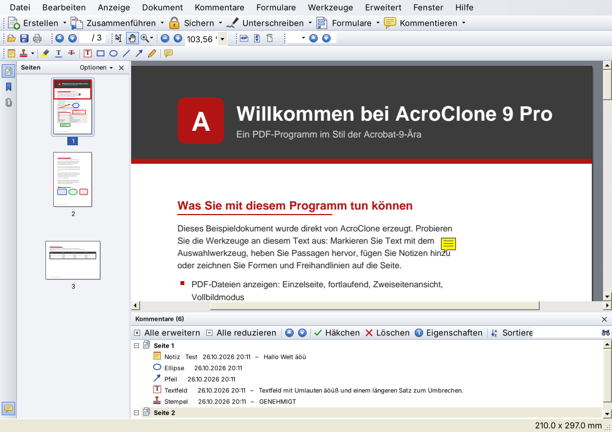
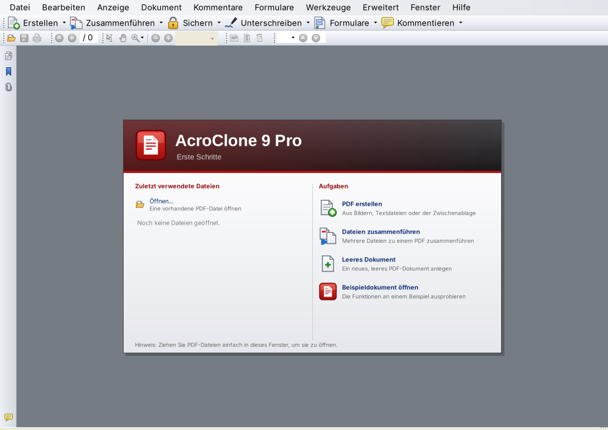
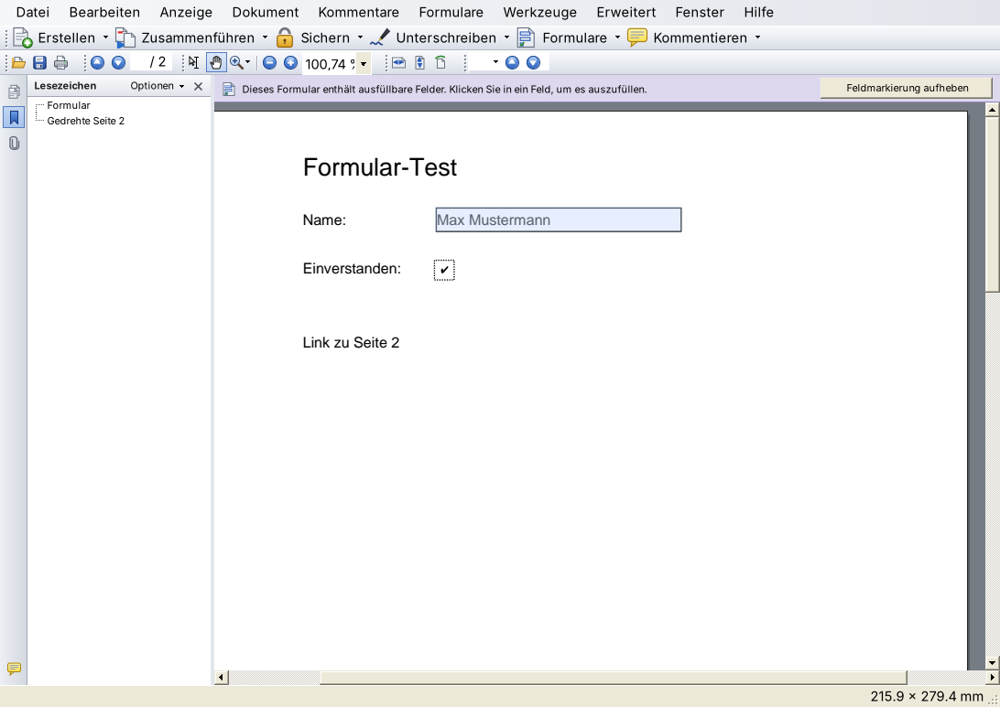
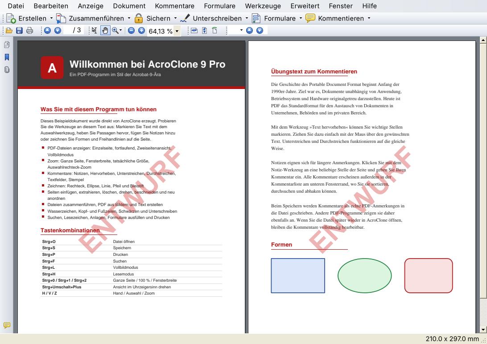

# AcroClone 9 Pro

Ein PDF-Programm für Windows im Look von **Adobe Acrobat 9** (2008) – geschrieben in C# mit
Windows Forms als **Visual-Studio-2010-Projekt** (.NET Framework 4.0).

> Hobbyprojekt, kein Produkt der Adobe Inc. „Adobe“ und „Acrobat“ sind Marken der Adobe Inc.
> Name, Programmsymbol und Grafiken sind eigene Entwürfe.



## Funktionen

**Anzeigen und Navigieren**
- PDF-Dateien öffnen (auch kennwortgeschützte), per Drag & Drop, Liste zuletzt verwendeter Dateien
- Seitenlayouts: Einzelne Seite, fortlaufend, Zweiseitenansicht (mit/ohne Deckblatt), Zwei Seiten fortlaufend
- Zoom: Ganze Seite, Fensterbreite, tatsächliche Größe, 8 %–6400 %, Strg+Mausrad, Auswahlrechteck-Zoom
- Ansicht drehen, Vollbildmodus (Strg+L), Lesemodus (Strg+H)
- Navigationsfenster mit Seitenminiaturen (roter Rahmen zeigt den sichtbaren Bereich), Lesezeichen und Anlagen
- Interne Links und Web-Links (mit Sicherheitsabfrage)
- Suchen über die Werkzeugleiste (Strg+F) und erweiterte Suche mit Trefferliste (Umschalt+Strg+F)
- Text markieren und kopieren, Schnappschuss-Werkzeug (Bereich als Bild kopieren), Messwerkzeug

**Kommentieren und markieren**
- Notizen mit gelbem Pop-up-Fenster, Text hervorheben, unterstreichen und durchstreichen
- Textfelder, Rechteck, Ellipse, Linie, Pfeil, Bleistift, Stempel („GENEHMIGT“, „ENTWURF“, eigene Texte …)
- Kommentare verschieben, in der Größe ändern, Eigenschaften (Farbe, Deckkraft, Linienstärke, Autor …)
- Kommentarliste am unteren Rand: sortieren, durchsuchen, abhaken, löschen
- Kommentare werden als **echte PDF-Anmerkungen** gespeichert und sind damit auch in anderen
  PDF-Programmen sichtbar. Beim erneuten Öffnen in AcroClone bleiben sie bearbeitbar.
- Kommentare reduzieren (fest in die Seiten einbetten)

**Bearbeiten von Dokumenten**
- Seiten einfügen (aus PDF, Bild, Text oder Zwischenablage), leere Seiten, extrahieren, löschen,
  drehen, beschneiden, per Drag & Drop in den Miniaturen neu anordnen, Dokument teilen
- Wasserzeichen sowie Kopf- und Fußzeilen (mit Seitenzahl, Seitenanzahl, Datum, Dateiname)
- Schwärzen: Bereiche markieren und anwenden (betroffene Seiten werden gerastert, der Originalinhalt
  wird tatsächlich entfernt)
- Unterschrift zeichnen oder eintippen und platzieren
- Formulare ausfüllen (AcroForm: Textfelder, Kontrollkästchen, Optionsfelder, Listen …),
  Formularfelder hervorheben
- Dokumenteigenschaften (Titel, Verfasser, Thema, Stichwörter bearbeitbar; Sicherheit; Details)
- Rückgängig/Wiederherstellen für Kommentare und Seitenoperationen

**Erstellen und Ausgeben**
- PDF aus Bildern (JPG, PNG, BMP, GIF, mehrseitige TIFF), Textdateien oder der Zwischenablage
- Dateien zu einem einzigen PDF zusammenführen („Sammelmappe“)
- Drucken und Druckvorschau (inkl. Kommentare), Export der Seiten als PNG/JPEG oder als Text

## Voraussetzungen

| Zweck | Voraussetzung |
|---|---|
| Ausführen | Windows 10 oder 11 (die mitgelieferte PDFium-Bibliothek benötigt Windows 10), .NET Framework 4.0 oder neuer (ist in Windows 10/11 als 4.8 enthalten) |
| Entwickeln | Visual Studio 2010 (oder neuer – die Projektmappe lässt sich in jeder neueren Version öffnen) |

## Bauen mit Visual Studio 2010

1. `AcroClone.sln` öffnen.
2. Konfiguration **Debug** oder **Release**, Plattform **Any CPU** wählen.
3. **F5** drücken.

Beim Erstellen werden `lib\pdfium\x86\pdfium.dll` und `lib\pdfium\x64\pdfium.dll` automatisch in die
Unterordner `x86` und `x64` neben `AcroClone.exe` kopiert. Zur Laufzeit lädt das Programm die zur
Prozessarchitektur passende DLL (32 oder 64 Bit).

Alternativ in der Visual-Studio-Eingabeaufforderung:

```bat
msbuild AcroClone.sln /p:Configuration=Release
```

Die fertige Anwendung liegt dann in `src\AcroClone\bin\Release\`. Zum Weitergeben genügen
`AcroClone.exe`, `AcroClone.exe.config` und die Ordner `x86` und `x64`.

## Fertige EXE

Unter [`dist/AcroClone-9.0.0-Windows.zip`](dist/AcroClone-9.0.0-Windows.zip) liegt eine fertig
kompilierte Version: entpacken und `AcroClone.exe` starten.

## Tastenkombinationen (Auswahl)

| Taste | Funktion |
|---|---|
| Strg+O / Strg+S / Umschalt+Strg+S | Öffnen / Speichern / Speichern unter |
| Strg+P / Strg+D / Strg+W | Drucken / Dokumenteigenschaften / Schließen |
| Strg+Z / Strg+Y | Rückgängig / Wiederherstellen |
| Strg+F / Umschalt+Strg+F | Suchen / Erweiterte Suche |
| Strg+0 / Strg+1 / Strg+2 | Ganze Seite / 100 % / Fensterbreite |
| Strg+Plus / Strg+Minus | Vergrößern / Verkleinern |
| Umschalt+Strg+Plus | Ansicht im Uhrzeigersinn drehen |
| Umschalt+Strg+N | Gehe zu Seite |
| Umschalt+Strg+D / R / I / T | Seiten löschen / drehen / einfügen / beschneiden |
| Strg+L / Strg+H / F4 | Vollbildmodus / Lesemodus / Navigationsfenster |
| H / V / Z / S / U | Hand / Auswahl / Zoom / Notiz / Hervorheben |
| Entf | Ausgewählten Kommentar löschen |

## Projektstruktur

```
AcroClone.sln                      Projektmappe (Visual Studio 2010, Format 11.00)
src/AcroClone/
  AcroClone.csproj                 C#-Projekt (.NET Framework 4.0, WinExe, AnyCPU)
  Program.cs                       Einstiegspunkt, Fensterverwaltung (ein Fenster pro Dokument)
  AppSettings.cs                   Einstellungen unter %APPDATA%\AcroClone\settings.ini
  Pdf/                             PDFium-Anbindung (P/Invoke), Rendering, Text, Formulare,
                                   Seitenobjekte, Dokumentinfo-Schreiber
  Model/                           Dokumentsitzung mit Rückgängig, Kommentarmodell,
                                   Zeichnen/Speichern der Kommentare, Dokumentwerkzeuge, PDF-Erstellung
  UI/                              Hauptfenster, Dokumentansicht, Navigations-/Kommentar-/Suchbereich,
                                   Theme im Acrobat-9-Stil, gezeichnete Symbole
  UI/Dialogs/                      Dialoge (Seiten, Wasserzeichen, Eigenschaften, Unterschrift …)
lib/pdfium/                        PDFium (x86/x64) und Lizenzen
docs/screenshots/                  Bildschirmfotos
```

## Bekannte Einschränkungen

- Lesezeichen werden angezeigt, können aber nicht bearbeitet werden.
- Es werden keine Kennwörter/Verschlüsselungen erzeugt (geschützte Dateien können geöffnet werden).
- Die Unterschrift ist eine sichtbare Unterschrift, keine zertifikatsbasierte digitale Signatur.
- Kommentare, die mit anderen Programmen erstellt wurden, werden angezeigt, sind aber nicht bearbeitbar.

## Drittanbieter

- [PDFium](https://pdfium.googlesource.com/pdfium/) (BSD-3-Clause/Apache-2.0), vorkompiliert von
  [pdfium-binaries](https://github.com/bblanchon/pdfium-binaries) (MIT). Lizenztexte in `lib/pdfium/licenses`.







*Die Bildschirmfotos wurden auf einem Testsystem unter Mono aufgenommen; unter Windows erscheint die
Oberfläche mit den Windows-Schriften (Tahoma) und Fensterrahmen.*
